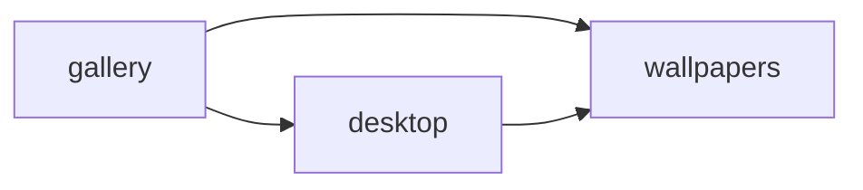

# wallpi

<!-- sbce:generated:start — projection of the specs; do not edit; `apply` regenerates from the system doc + per-BC package docs -->
> Browse wallpapers from configured image APIs and put the chosen one, at its largest, on every screen of this Mac.

## Capabilities
- **wallpapers** — offer the configured wallpaper sources and the wallpapers each one provides, down to the largest available original · [`spec`](wallpi/src/main/java/ch/survalit/wallpi/wallpapers/package-info.java)
- **desktop** — put a chosen wallpaper's largest original on every screen of this Mac · [`spec`](wallpi/src/main/java/ch/survalit/wallpi/desktop/package-info.java)
- **gallery** — show every configured source as a section of wallpaper cards and apply the card that is chosen · [`spec`](app/src/gallery/package-info.md)

## Components
<!-- projection of the system doc's ## Components wiring; nodes = BCs, edges = declared calls/events; never inferred from code -->

<!-- sbce:generated:end -->

## Prerequisites

macOS, Java 25+, Maven 3.9+. Node.js only for the browser tests.

## Run

```
./start.sh
```

Builds on first start, serves http://localhost:9447 (loopback only) and opens it in the browser. Run `./start.sh --build` after changing Java code; frontend changes in `app/src` show on reload.

```
./stop.sh
```

Stops every wallpi instance listening on port 9447; another program on that port is reported and left running.

The first apply triggers a macOS prompt to let Java control System Events — allow it, or applying fails with error `-1743`.

## Configuration

Sources are read from `~/.wallpi/sources.json` on every page load; a default with Star Trek and nature sources is created on first start. Each `url` is a Wallhaven or Unsplash API query:

```json
[
  {
    "title": "Star Trek",
    "description": "Starships, bridges and the final frontier",
    "url": "https://wallhaven.cc/api/v1/search?q=star%20trek&atleast=2560x1440"
  },
  {
    "title": "Nature on Unsplash",
    "description": "Landscape photography from Unsplash",
    "url": "https://api.unsplash.com/search/photos?query=nature%20landscape&orientation=landscape",
    "seasonal": true
  }
]
```

`"seasonal": true` adds a season filter to the source's section.

Unsplash sources need the app's Access Key in `~/.wallpi/unsplash.json`; it is read on every request, so no restart is needed. Without it, Unsplash sections show an error and Wallhaven keeps working:

```json
{"accessKey": "your-unsplash-access-key"}
```

| Setting | Default | Purpose |
|---|---|---|
| `wallpi.sources` | `~/.wallpi/sources.json` | sources file |
| `wallpi.unsplash.key-file` | `~/.wallpi/unsplash.json` | Unsplash access key file |
| `wallpi.pictures` | `~/Pictures/wallpi` | where applied originals are stored |

Override `wallpi.*` settings with environment variables, e.g. `WALLPI_PICTURES=~/Desktop/walls ./start.sh`.

## Test

```
cd wallpi && mvn verify
cd tests && npm install && npx playwright install && npx playwright test
```

The Maven build runs the server-side requirement tests; Playwright runs the gallery tests in Chromium, Firefox and WebKit against stubbed server boundaries.
